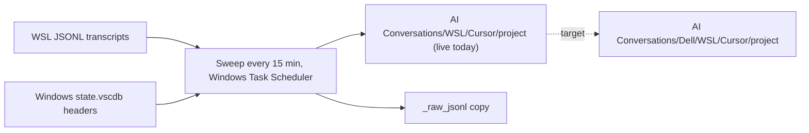

# Cursor Conversation Tracking

This is the single map of how Cursor conversations are produced, where every piece lands, what the vault already captures, and what the end-state loop looks like. It sits beside [[20_Progress/Projects/AI Use/Conversations/Claude Code Session Source|Claude Code Session Source]] (the Claude twin of this note) and borrows its reasoning from [[20_Progress/Projects/AI Use/Conversations/Conversation Loop Sources|Conversation Loop Sources]]. Facts come from two research passes on 2026-11-18/19 on the Dell. Anything not proven is marked **unverified**.

**Status.** Research and design only. Per the Dell gate (P12) in the [[20_Progress/Projects/AI Use/Conversations/Conversation Loop Build Plan|Conversation Loop Build Plan]], the Dell builds no loop until that gate is filled. Cursor exporters are P15. Until then, Dell work is WSL health only (see [[20_Progress/Projects/AI Use/Conversations/Prompts - Dell/D0 - WSL Claude Code Health Fix|D0]]).

## 1. Decisions already made (owner)

| Decision | Meaning |
|---|---|
| Every Cursor window is launched through WSL, on the owner's own projects. Nothing launches from Windows. | There is no future "Windows Cursor" conversation stream. |
| Live exporters write to `AI Conversations/Dell/WSL/Cursor/`. | Machine-first layout, same as Claude ([[20_Progress/Projects/AI Use/Conversations/Legacy Layout and Archives|Legacy Layout and Archives]]). |
| Old Windows Cursor notes are **archived**. Existing WSL notes are **not** archived and stay visible. | 16 session notes plus 9 index/archive files under `Dell/Windows/Cursor` get archived. `Dell/WSL/Cursor` (62 session notes plus 25 index files) stays. |
| `merget` is not the owner's and is removed from every AI platform. | Done 2026-11-19, see section 11. |

Not decided yet (owner said these are future decisions): whether the SQLite-only sessions are a required second source, and when the Windows notes are archived. See section 12.

## 2. The three stores

Cursor under WSL is a Windows Electron UI driving a Linux `~/.cursor-server`. That split is why one conversation lives in three places.

| Store | Where | Holds | Holds NOT |
|---|---|---|---|
| **A. Agent transcript** | WSL `~/.cursor/projects/<slug>/agent-transcripts/<uuid>/<uuid>.jsonl` | Roles, text, `tool_use` blocks (name and input), `turn_ended` markers, subagent files in `subagents/` | Tool results, thinking, model, usage, timestamps (only an inline `<timestamp>` tag in about 60% of user messages) |
| **B. Conversation DB** | Windows `%APPDATA%\Cursor\User\globalStorage\state.vscdb` (about 806 MB, WAL) | Every message ("bubble"), tool results, model name, headers, checkpoints, diffs | Nothing is exported by Cursor itself |
| **C. Config and project state** | WSL `~/.cursor/`, `~/.cursor-server/`, and the workspace `.cursor/` | Hooks, MCP, rules, plans, skills, snapshots, edit ledger | Conversation content |

The raw-content difference matters: for session `c38a3458`, the DB had 256 bubbles and 169 tool results, while the JSONL had 185 `tool_use` calls and no results. **The JSONL is the intent; the DB is the evidence.** This mirrors the "write before seeing" and "criteria drift" concerns in [[20_Progress/Projects/AI Use/Conversations/Conversation Loop Sources|Conversation Loop Sources]]: a reviewer judging only intent cannot see failure.

## 3. What lives where

### 3.1 Home directory (WSL `~/.cursor/`)
- `projects/<slug>/` holds `agent-transcripts/`, `agent-tools/`, `terminals/`, `canvases/`, `mcps/`, `uploads/`, `assets/`. The slug is the workspace path flattened.
- `hooks.json` (user hooks; currently `sessionStart` runs `./hooks/mcp-preflight.sh`), `mcp.json` (mode 0600; never read or print it, see the secrets rule), `cli-config.json` (`approvalMode: allowlist`), `agent-cli-state.json`, `ide_state.json`.
- `plans/` (30 plan files), `agents/`, `skills/`, `worktrees/`.
- Windows `~/.cursor/` still exists with 20 older transcripts and its own `mcp.json`, plans and skills. It is vestigial under the WSL-only rule.

### 3.2 Remote server (WSL `~/.cursor-server/data/`)
- `User/workspaceStorage/` small per-workspace state, `snapshots/` (about 887 MB), `agent-harness/`, logs.
- `User/globalStorage/anysphere.cursor-agent-host/data.sqlite` exists but the tables are empty. The conversation DB did **not** move to WSL.
- `anysphere.cursor-agent-worker/agent-cli/` embeds the CLI (version 2026.10.22). `agent` and `cursor-agent` are not on PATH.

### 3.3 Inside a workspace (`<repo>/.cursor/`)
For the portfolio repo: `ORCHESTRATION.md`, `agents/`, `commands/`, `skills/`, `rules/*.mdc`, `config/bugbot.yaml`, `golden-files.txt`, `hooks.json`, `hooks/*.mjs`, `ledger/edits.jsonl`.

Project hooks: `sessionStart` runs `session-context.mjs`; `afterFileEdit` and `afterTabFileEdit` run `record-edit.mjs`; `beforeShellExecution` runs `guard-pr.mjs`, which returns "ask" for `gh pr create|ready`. The ledger has one row (a golden-file edit at 2026-11-19T05:30:46Z), consistent with the project hook firing under WSL. **Not proven.**

### 3.4 Windows state DB internals
- `composerHeaders` (245 rows): `composerId`, `workspaceId`, `createdAt`, `lastUpdatedAt`, `isArchived`, `isSubagent`, `value` (JSON with mode, workspace identifier, lines added/removed, tracked repos).
- `cursorDiskKV` (81,102 rows): `agentKv` 50,549, `bubbleId` 26,138, `composerData` 284, `checkpointId` 399, `inlineDiff` 182, `ofsContent` 889. `composerData.modelConfig.modelName` carries the model per session (composer-2.5, gpt-5.5, claude-opus-4-8, and others).
- Bubble `toolFormerData`: name, params, result, status, user decision. `tokenCount` was zero or empty for all four sessions checked.
- `~/.cursor/ai-tracking/ai-code-tracking.db` (Windows side): 1,050 AI code hashes with file, model and conversation id; 37 scored commits.
- A May state backup (234 MB) is stale and must not be treated as current.

### 3.5 Memory
Cursor documents **no memory feature** beyond rules (`.cursor/rules/*.mdc`, root and nested `AGENTS.md`, User Rules, Team Rules), skills, plans, and checkpoints. Checkpoints are local and separate from Git. Treat "memory" in Cursor as rules plus plans, not a store the loop can read as conversation.

## 4. Are transcripts auto-generated?
Yes, for agent-style sessions in a WSL window: the JSONL appears without any setup, and hooks receive `transcript_path` (null if disabled). Coverage by header mode:

| Mode | JSONL + DB | DB only | Empty |
|---|---|---|---|
| agent | 72 | 47 | 36 |
| chat | 9 | 41 | 33 |
| plan | 4 | 0 | 3 |
| debug | 1 | 0 | 0 |

So about **35% of sessions have a transcript**, about **88 exist only in SQLite**, and about 69 are empty drafts. The current exporter reads JSONL only (section 6), so those 88 are invisible to the vault.

## 5. IDE vs Agents window vs CLI

| Surface | Conversation store | Transcript JSONL | Hooks | Verified? |
|---|---|---|---|---|
| IDE (agent/plan/debug) | Windows `state.vscdb` | Yes, WSL | Project and user hooks | Seen in data |
| IDE chat mode | Windows `state.vscdb` | Rarely (9 of 83) | Same | Seen in data |
| Agents window | Documented as a local searchable index | Unknown | Unknown | **Unverified** |
| CLI (`agent`, `-p`, `resume`) | Docs do not say. A third-party article says `~/.cursor/chats/*/*/store.db`; that path does not exist here | Unknown | Docs do not state support. Forum reports say some events and token usage are missing | **Unverified** |
| Cloud agents | Cursor backend | No | Ignore user `hooks.json`, no session start/end | Documented |

Rule for the loop: assume the JSONL plus the DB are the only on-disk truth until a CLI and an Agents-window session are run once and their files diffed (section 12). The CLI's `--output-format stream-json` is the only documented structured stream, and only in print mode.

## 6. The existing pipeline (as built)

Spec lives in [[30_Order/System/cursor-workflow/Cursor Workflow|Cursor Workflow]]. The exporter is `export-cursor-sessions.py` (about 1,000 lines) with `sweep-cursor-sessions.ps1`, `register-cursor-export-task.ps1` and `redact_secrets.py`. The task `Jarvis-Cursor-Session-Export` runs every 15 minutes through the Windows Python and reads WSL transcripts over `\\wsl.localhost\Ubuntu\...`. Logs show it ran daily through 2026-11-18 23:35. (My first pass said it stopped on 2026-10-08. That was wrong: 10-08 was the manual reorganization date, and there were no October transcripts.)

Logic: join transcript to `composerHeaders`; skip no-header, archived, subagent, draft, no-assistant, no-jsonl; dedup by `_raw_jsonl/<id>.jsonl` or `session_id:` in a note head; project name is the workspace folder basename; a watermark `last_processed_updated_at` advances even for skipped sessions.

**Measured coverage:** 87 transcripts (67 WSL, 20 Windows), 82 with notes, 5 without, none duplicated, none orphaned. Notes: 62 plus 16 session notes, plus 4 non-Dell notes dated 2026-11-18. Transcripts by month: Mar 6, Apr 12, May 10, Jun 24, Jul 17, Aug 9, Sep 5, Oct 0, Nov 4. How this compares with Claude: [[20_Progress/Projects/AI Use/Conversations/Platform Coverage|Platform Coverage]] and [[20_Progress/Projects/AI Use/Conversations/Capture Pipeline - As Built|Capture Pipeline - As Built]].

## 7. Defects found in the existing pipeline

| # | Defect | Consequence | Fix direction |
|---|---|---|---|
| 1 | **Output path has no machine segment.** Hardcoded `WSL or Windows / Cursor / <project>` (about line 781, plus rollup about line 945). README says machine-first was built for Claude only. | New notes land in `AI Conversations/WSL/Cursor`, not `Dell/WSL/Cursor`. | Add machine segment from hostname via `capture-projects.json` (`DESKTOP-3VBG0JH` = Dell, `gupta-builds` = Acer). Move the 4 new notes. |
| 2 | **Notes freeze at first export.** `c38a3458`: exported at 22:28 with 2 turns, now 7 user turns and 185 tool calls. `_raw_jsonl` copy is made once. | Every note is a snapshot of the first sweep to see it. | Refresh when the transcript mtime is newer, or export only on completed `turn_ended`. |
| 3 | **Dedup marker conflicts with hard delete.** The 2026-11-07 rule says a deleted note is never recreated (the `.exported` marker). Cursor's markers are `_raw_jsonl` and `session_id` in a note. | Review deleting the raw copy makes the exporter silently re-create notes. See [[20_Progress/Projects/AI Use/Conversations/Conversation Layer|Conversation Layer]]. | Use an `.exported` tombstone, same as Claude. |
| 4 | **Project name collisions.** `projects/portfolio` and `projects/hub/portfolio` both give `portfolio`. | Two repos in one folder. | Key on the full slug, display the basename. |
| 5 | **88 SQLite-only sessions are invisible.** | About two-thirds of agent/chat history never reaches the vault. | Section 12, decision 1. |
| 6 | **Runs on Windows only** (Task Scheduler plus Windows Python). | Hostile to the "everything lives on WSL" rule. | Move to a WSL timer reading the DB through `/mnt/c`, or accept Windows as the reader and call it out. |
| 7 | **Note format.** Cursor notes use `status: raw` without created/updated/review state. | Does not match [[20_Progress/Projects/AI Use/Conversations/Export Conformance|Export Conformance]]. | Conform in P15. |
| 8 | **Redaction is a third implementation** (`redact_secrets.py`). Command lines are the known weak spot. | Secrets could leak into notes. | One shared redactor, see [[20_Progress/Projects/AI Use/Conversations/Capture Scripts|Capture Scripts]]. |

## 8. Claude Code vs Cursor

| | Claude Code | Cursor |
|---|---|---|
| Transcript | One project-keyed JSONL tree with results and usage | Thin JSONL in WSL, rich SQLite on Windows |
| Prompt id | `prompt_id` | `generation_id` (plays the same role), plus `conversation_id` |
| Hook events | 33, with `transcript_path` | 21, with `transcript_path` in the common fields |
| Retention | 60-day sweep (`cleanupPeriodDays`) | No documented local retention. Users report huge DBs and update-wipe risk |
| Model/usage | In the transcript | Model in the DB. Tokens unconfirmed |
| Import | n/a | Cursor imports Claude and Codex hooks by default (**does not prove they fire here**) |
| Exporter | `wsl-session-export.ps1` and a SessionEnd hook | Windows task, 15-minute sweep |

Cursor's 21 events: `sessionStart`, `sessionEnd`, `preToolUse`, `postToolUse`, `postToolUseFailure`, `subagentStart`, `subagentStop`, `beforeShellExecution`, `afterShellExecution`, `beforeMCPExecution`, `afterMCPExecution`, `beforeReadFile`, `afterFileEdit`, `beforeSubmitPrompt`, `preCompact`, `stop`, `afterAgentResponse`, `afterAgentThought`, `beforeTabFileRead`, `afterTabFileEdit`, `workspaceOpen`. Options: `timeout`, `failClosed` (default false), `matcher`, `loop_limit`. Exit 2 blocks, other non-zero fails open. Sources: Enterprise (`/etc/cursor/hooks.json`), Team, Project, User, plugins. Which machine's user `hooks.json` a WSL window reads is not documented. **Unverified.**

## 9. End-state design (after P12 and P15)

The principle is the one in [[20_Progress/Projects/AI Use/Conversations/Conversation Loop Design|Conversation Loop Design]]: capture is a side effect, review is a separate weekly act, and nothing the reviewer proposes is applied without the owner.

1. **Facts, from hooks.** A WSL-only, fail-open, bounded user hook on `afterShellExecution`, `afterFileEdit`, `afterMCPExecution`, `postToolUse` and `stop` writes one row per event to `logs/events-<machine>.jsonl` in the [[20_Progress/Projects/AI Use/Conversations/Per-Prompt Record|Per-Prompt Record]] shape (session, agent, prompt_id, tool, target, ok, ms), no prompt text. `generation_id` fills `prompt_id`; the row's agent value is `cursor`. This file is local, ignored by Git and Syncthing.
2. **Notes, from the exporter.** After the path fix, the sweep writes `AI Conversations/Dell/WSL/Cursor/<project>/`, refreshes in place, and keeps `_raw_jsonl`. Notes never go in by hand and stay on the writing machine ([[20_Progress/Projects/AI Use/Conversations/Legacy Layout and Archives|Legacy Layout and Archives]], 2026-11-05 decision).
3. **Evidence, from the DB (if adopted).** A read-only DB reader adds model, tool results and the SQLite-only sessions to a note section, clearly labelled DB-sourced.
4. **Review.** The blind weekly pass in [[20_Progress/Projects/AI Use/Conversations/Weekly Review Protocol|Weekly Review Protocol]] treats Cursor as one more platform, with Cursor tags in the [[20_Progress/Projects/AI Use/Conversations/Failure Taxonomy|Failure Taxonomy]]. One change per week goes in the [[20_Progress/Projects/AI Use/Conversations/Intervention Ledger|Intervention Ledger]]; the [[20_Progress/Projects/AI Use/Conversations/Local Reviewer|Local Reviewer]] is the second reviewer at stage B.
5. **Self-improvement targets.** Cursor's own levers are `.cursor/rules/*.mdc`, `AGENTS.md`, skills and `hooks.json`. A weekly review change is a diff to one of those, never a silent edit.

Scope for the Dell gate is six repos (Jarvis, internship-research-loop, second-brain-claudekit, portfolio, CausalOps, tradingview). Cursor also opens other projects, so Cursor scope needs its own list.

## 10. Source map for Cursor (the equivalent of "golden resources")
The ten sources in [[20_Progress/Projects/AI Use/Conversations/Conversation Loop Sources|Conversation Loop Sources]] are Claude-centred. The transferable ones are Buçinca (write before seeing), Shankar (criteria drift), Tang (failure taxonomy), AgentDiet (bloat) and Dunivin (codebook). For platform facts Cursor needs its own, lower-evidence list:
- Cursor docs: Hooks, third-party hooks, CLI headless, Agent overview, Cloud agent security. Primary but incomplete: the CLI overview, rules and Agents-window pages returned 404 when fetched.
- vibe-replay, "Cursor local storage". Third party, unofficial. Use as a hint, not a fact.
- Cursor forum bug threads (DB growth, update wipes, missing hook events). Anecdotal.

## 11. Done this pass: `merget` removal
`merget` was in three Windows places, all removed with backups in `~/.claude/backups/merget-removal-20261118T235513/`:
- Cursor: `~/.cursor/hooks.json` (all 16 events pointed at `merget-hooks.exe`; verified none were anything else).
- Copilot: `hooks/merget.json`, and its plugin and marketplace keys in `settings.json`.
- Claude Code: the plugin entry, the marketplace entry and the cached folder.

The binary was never on disk. Codex, Gemini, Kiro, Continue, OpenCode and WSL were clean. Deleting the Windows Cursor `hooks.json` leaves no user hook file there, so any future Windows hook file should be treated as foreign until proven otherwise.

## 12. Open questions (future decisions, nothing built)

**Owner decisions**
1. Are the 88 SQLite-only sessions a required second source? Doing so makes the Windows DB a hard dependency of the loop.
2. When do the 16 Windows Cursor notes (plus 9 index files) get archived? Owner direction: archive them; keep WSL notes visible.
3. Which repos are in Cursor scope on the Dell?

**Empirical checks (third pass, small)**
1. Do the Claude and Codex export hooks fire in a Cursor session? The Cursor log shows a watcher on `~/.codex/hooks.json`, and `~/.claude/jarvis-session-activity.jsonl` does not exist on WSL, so the earlier test was inconclusive. Needs a harmless marker hook.
2. Do the Agents window and the CLI write different stores? Needs one session in each, then a file diff.
3. Does a WSL window read user hooks from the WSL or Windows home? The [[30_Order/System/cursor-workflow/Cursor Workflow|Cursor Workflow]] note says WSL; the docs say nothing.
4. Why do 5 transcripts have no note, and why does `composerData` have 284 rows against 245 headers?
5. Is `tokenCount` ever populated?

**Not read in full:** exporter redaction code, `~/.cursor/plans`, `workspaceStorage` internals, and the Monthly Review Protocol and Machine Audit bodies ([[20_Progress/Projects/AI Use/Conversations/Monthly Review Protocol|Monthly Review Protocol]], [[20_Progress/Projects/AI Use/Conversations/Machine Audit 2026-10-22|Machine Audit 2026-10-22]]).

## 13. Rules this note must keep obeying
- Secrets stay in `~/.mcp.env`; Cursor's `mcp.json` is never read or printed.
- Hooks fail open and are bounded; Cursor hooks follow the same rule as Claude's.
- The vault is written by exporters and by the owner. `Jarvis-GitAutoSync` is the only Git writer. Raw events and logs never enter the vault.
- Project rule for the portfolio repo: never commit; pnpm only.
- One dated note per build goes in `Prompts - Dell/`, not in this note.

## Related
[[20_Progress/Projects/AI Use/Conversations/Conversation Layer|Conversation Layer]] · [[20_Progress/Projects/AI Use/Conversations/Conversation Layer Postmortem|Conversation Layer Postmortem]] · [[20_Progress/Projects/AI Use/Conversations/Conversation Loop Design Postmortem|Conversation Loop Design Postmortem]] · [[20_Progress/Projects/AI Use/Conversations/Capture Registration|Capture Registration]] · [[60_Claude/05_Clippings/AI Conversations/README|AI Conversations README]]
